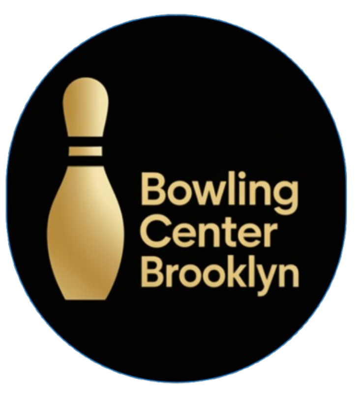
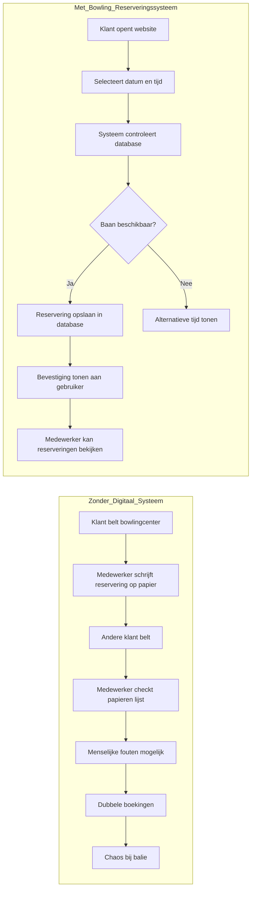
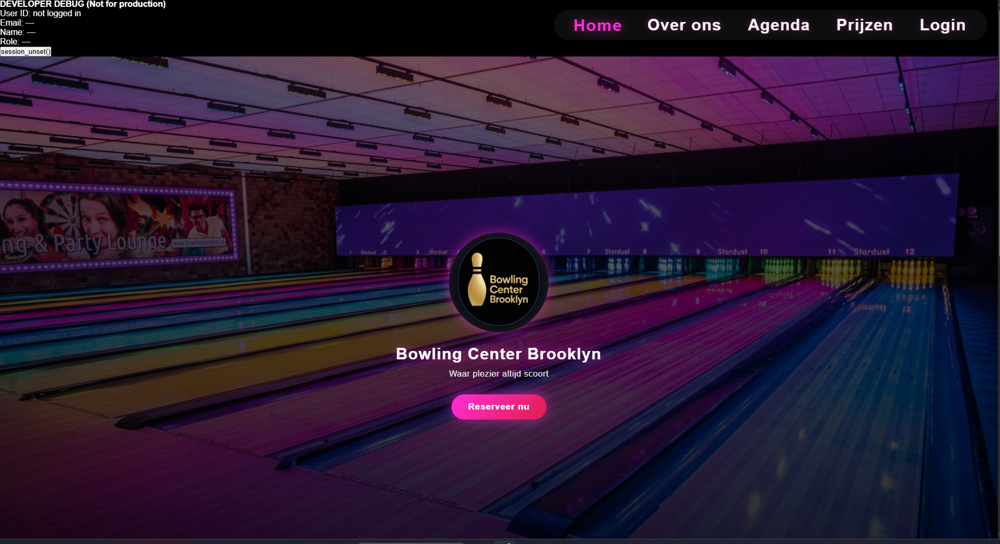
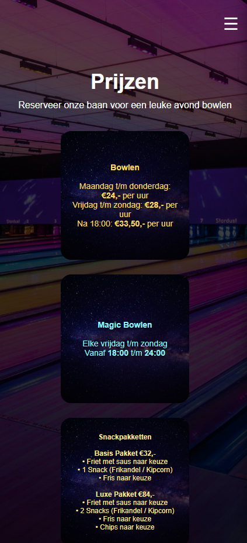
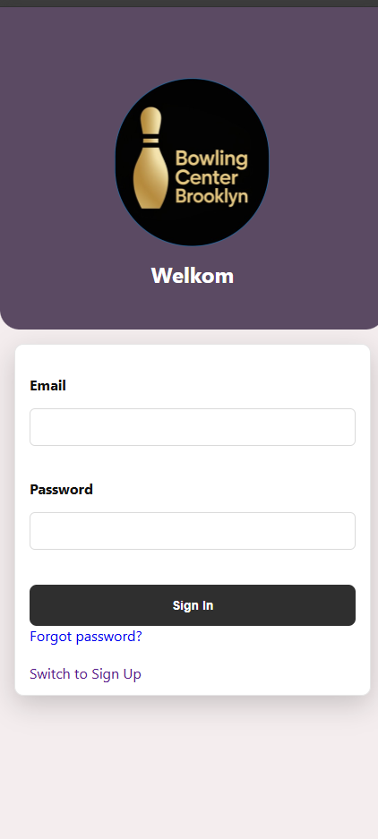

# Bowling Center Brooklyn Documentatie

  

<!-- vscode-markdown-toc -->
* 1. [Project Uitleg](#ProjectUitleg)
* 2. [Gebruiker rollen](#Gebruikerrollen)
* 3. [Database Structuur](#DatabaseStructuur)
	* 3.1. [Users](#Users)
	* 3.2. [Reservations](#Reservations)
	* 3.3. [Player](#Player)
	* 3.4. [Lane](#Lane)
	* 3.5. [Rounds](#Rounds)
	* 3.6. [Score](#Score)
	* 3.7. [Payments](#Payments)
	* 3.8. [Relaties tussen tabellen](#Relatiestussentabellen)
* 4. [Setup guide](#Setupguide)
* 5. [Features](#Features)
* 6. [Tech stack](#Techstack)
* 7. [Security](#Security)
* 8. [Screenshots](#Screenshots)
* 9. [Known Issues](#KnownIssues)
* 10. [Verbetervoorstellen](#Verbetervoorstellen)
* 11. [Andere linkjes](#Anderelinkjes)
	* 11.1. [Documentatie](#Documentatie)
	* 11.2. [Kanban Board](#KanbanBoard)
	* 11.3. [Main Issues](#MainIssues)
	* 11.4. [Sub Issues](#SubIssues)

<!-- vscode-markdown-toc-config
	numbering=true
	autoSave=true
	/vscode-markdown-toc-config -->
<!-- /vscode-markdown-toc -->

##  1. Project Uitleg

Bowling Center Brooklyn is een web applicatie die gemaakt is om bowling baan reservaties te kunnen beheren. Het systeem zorgt voor minder handmatige boekingen door gebruikers en medewerkers reservaties te kunnen laten maken door een digitale platform.  
Daarnaast helpt het systeem om dubbele bookingen aan te maken en verbetert productiviteit voor de medewerkers.

##  2. Gebruiker rollen
Het systeem heeft drie soorten rollen:

Klant
- Kan een account aanmaken
- Kan reservaties aanmaken
- Kan eigen reservaties inzien

Medewerker
- Kan een reservatie aanmaken
- Kan alle reservaties inzien 

Owner
- Kan alles wat een medewerker kan doen 
- Kan gebruikers met elke rol aanmaken 

##  3. Database Structuur

De applicatie maakt gebruik van een **MySQL-database genaamd `bowlingdb`**.  
Deze database beheert alle gegevens van gebruikers, reserveringen, spelers, bowlingbanen, scores en betalingen.

Het systeem zorgt ervoor dat:
- reserveringen gekoppeld zijn aan gebruikers
- spelers gekoppeld zijn aan reserveringen
- scores gekoppeld zijn aan spelers en rondes
- betalingen gekoppeld zijn aan reserveringen

---

###  3.1. Users

De tabel **users** bevat alle geregistreerde gebruikers van het systeem.

| Kolom | Type | Beschrijving |
|------|------|-------------|
| id | int | Unieke ID van de gebruiker |
| name | varchar | Naam van de gebruiker |
| email | varchar | Emailadres (uniek) |
| password_hash | varchar | Versleuteld wachtwoord |
| role | varchar | Rol van de gebruiker (bijv. klant of medewerker) |
| created_at | datetime | Datum waarop de gebruiker is aangemaakt |

---

###  3.2. Reservations

De tabel **reservations** bevat alle reserveringen van bowlingbanen.

| Kolom | Type | Beschrijving |
|------|------|-------------|
| id | int | Unieke reservering ID |
| user_id | int | Gebruiker die de reservering heeft gemaakt |
| reservation_date | date | Datum van de reservering |
| timeslot_start | time | Starttijd |
| timeslot_end | time | Eindtijd |
| adults | int | Aantal volwassenen |
| children | int | Aantal kinderen |
| snackbox_basic | int | Aantal basis snackboxen |
| snackbox_luxury | int | Aantal luxe snackboxen |
| subtotal | decimal | Bedrag exclusief BTW |
| vat | decimal | BTW bedrag |
| total_amount | decimal | Totaalbedrag |
| is_paid | boolean | Geeft aan of de reservering betaald is |
| created_at | datetime | Datum van aanmaak |

Elke reservering is gekoppeld aan een gebruiker via **user_id**.

---

###  3.3. Player

De tabel **player** bevat de spelers die deelnemen aan een reservering.

| Kolom | Type | Beschrijving |
|------|------|-------------|
| player_id | int | Unieke speler ID |
| player_name | varchar | Naam van de speler |
| age | int | Leeftijd |
| reservation_id | int | Reservering waaraan de speler gekoppeld is |
| total_score | int | Totale score van de speler |
| created_at | datetime | Datum van aanmaak |

---

###  3.4. Lane

De tabel **lane** bevat de bowlingbanen.

| Kolom | Type | Beschrijving |
|------|------|-------------|
| lane_id | int | Unieke baan ID |
| lane_number | int | Nummer van de bowlingbaan |
| reservation_id | int | Reservering gekoppeld aan de baan |
| max_players | int | Maximum aantal spelers |

---

###  3.5. Rounds

De tabel **rounds** registreert de verschillende speelrondes.

| Kolom | Type | Beschrijving |
|------|------|-------------|
| id | int | Unieke ronde ID |
| player_id | int | Speler die de ronde speelt |
| score_id | int | Score gekoppeld aan de ronde |
| lane_id | int | Baan waarop gespeeld wordt |
| created_at | datetime | Datum van aanmaak |
| status | varchar | Status van de ronde |

---

###  3.6. Score

De tabel **score** bevat de scores van spelers.

| Kolom | Type | Beschrijving |
|------|------|-------------|
| score_id | int | Unieke score ID |
| player_id | int | Speler die de score heeft behaald |
| round_id | int | Ronde waarin de score is behaald |
| total_score | int | Totale score |
| high_score | boolean | Geeft aan of dit een hoogste score is |

---

###  3.7. Payments

De tabel **payments** bevat de betalingen voor reserveringen.

| Kolom | Type | Beschrijving |
|------|------|-------------|
| id | int | Betaling ID |
| reservation_id | int | Reservering waarvoor betaald is |
| stripe_session_id | varchar | Stripe sessie ID |
| stripe_payment_intent | varchar | Stripe payment intent |
| payment_status | varchar | Status van betaling |
| amount | decimal | Betaald bedrag |
| created_at | datetime | Datum van betaling |

De applicatie maakt gebruik van **Stripe** voor het verwerken van online betalingen.

---

###  3.8. Relaties tussen tabellen

De belangrijkste relaties in de database zijn:

- Een **user** kan meerdere **reservations** hebben  
- Een **reservation** kan meerdere **players** bevatten  
- Een **player** kan meerdere **rounds** spelen  
- Een **round** hoort bij een **lane**  
- Scores worden gekoppeld aan **players** en **rounds**  
- Een **reservation** kan een **payment** hebben  

##  4. Setup guide

> [!tip] Deze gedeelte is in het engels omdat het makkelijker te volgen is.

1. Download XAMPP on your machine. Make sure to set this up and for ease of use, ensure that the program always runs with administrator privilieges
2. Clone the project in your htdocs folder (For windows: C:/xampp/htdocs)
3. Start up the Apache service and the MySQL service. 
4. Get the SQL Database code and paste this in your local phpmyadmin environment
5. Run localhost/(gitfolderhere) on your browser and voila!

There are possibly more approaches to set this project up but this is how we got it working.

##  5. Features

1.  Reserveren
Je kan een reservering maken door op de website naar de reserveringspagina te gaan. Daar kiest de klant een datum, een tijd en een bowlingbaan. Daarna vult de klant zijn gegevens in en kan de reservering worden opgeslagen. Zo kan een klant online een baan reserveren zonder te hoeven bellen. 

2. Beschikbare banen bekijken
Wanneer een klant wil reserveren, kan hij zien welke banen beschikbaar zijn. Het systeem controleert welke banen al bezet zijn op dat moment. Daardoor kan een klant alleen een vrije baan kiezen en worden dubbele reserveringen zoveel mogelijk voorkomen.
3. Datum en tijd kiezen
Bij het maken van een reservering kan de klant zelf een datum en tijd kiezen. Dit maakt het makkelijk om een reservering te plannen op een moment dat het voor de klant uitkomt.
4. Aantal personen invullen
Tijdens het reserveren kan de klant aangeven met hoeveel personen hij komt. Op basis daarvan kan het systeem rekening houden met het aantal volwassenen en kinderen en hoeveel banen er nodig zijn.
5. Inloggen
Een gebruiker kan inloggen op de website met een e-mailadres en wachtwoord. Als de gegevens kloppen, krijgt de gebruiker toegang tot zijn account of dashboard. Dit maakt het mogelijk om persoonlijke gegevens en reserveringen te bekijken.
6. Registreren
Als een klant nog geen account heeft, kan hij zich registreren op de website. Daarbij vult de gebruiker zijn gegevens in, zoals naam, e-mail en wachtwoord. Daarna wordt een account aangemaakt en kan de gebruiker inloggen.
7. Uitloggen
Een gebruiker kan ook weer uitloggen van de website. Daardoor wordt de sessie afgesloten en kan niemand anders zomaar in dat account verder werken.
8. Prijzen bekijken
Op de website is een pagina aanwezig waar klanten de prijzen van de bowlingbaan kunnen bekijken. Zo weet een klant van tevoren wat een reservering ongeveer kost en op welke tijden er gespeeld kan worden.
9. Over ons bekijken
Er is ook een pagina met informatie over het bowlingcentrum. Hier kan een bezoeker meer lezen over het bedrijf en wat de website of bowlingbaan aanbiedt.
10.  Reserveringen terugzien
Een klant kan zijn eigen reserveringen terugzien op de website. Hierdoor kan de klant controleren of een reservering goed in het systeem staat en welke datum en tijd gekozen zijn.
11. Reserveringen bekijken als medewerker
Een medewerker kan een overzicht zien van de reserveringen die zijn gemaakt.
12. Gebruikersoverzicht
De eigenaar of beheerder kan een overzicht van gebruikers bekijken. Zo kan worden gezien welke accounts er in het systeem staan.
13. Beveiligd inloggen
De website gebruikt beveiliging bij het inloggen, zoals versleutelde wachtwoorden. Dit zorgt ervoor dat wachtwoorden niet zomaar leesbaar in de database staan.
14. Databasekoppeling
De website is gekoppeld aan een database. Hierdoor kunnen gegevens zoals gebruikers en reserveringen worden opgeslagen en later weer worden opgehaald.
15. Automatische controle op bezetting
Tijdens het reserveren controleert het systeem of een baan al bezet is. Daardoor kan een klant niet zomaar dezelfde baan op dezelfde tijd reserveren als iemand anders.

##  6. Tech stack
Voor het project gebruiken we een mix van HTML, CSS, PHP, en JavaScript in combinatie met MySQL voor de database in XAMPP
##  7. Security
Het systeem heeft basis security maatregelen zoals het voorkomen van
 
- SQL Injection
- Passworden zijn gehashed
- Rol gebaseerd toegang controle

##  8. Screenshots

##  9. Known Issues

##  10. Verbetervoorstellen

##  11. Andere linkjes
###  11.1. Documentatie
* [Documentatie](https://github.com/Bambaclad1/bowlingcenter-brooklyn/wiki)

###  11.2. Kanban Board
* [Kanban Board](https://github.com/users/Bambaclad1/projects/1)

###  11.3. Main Issues
- [User Stories](https://github.com/Bambaclad1/bowlingcenter-brooklyn/issues/15)

###  11.4. Sub Issues
- [Eigenaar User Stories](https://github.com/Bambaclad1/bowlingcenter-brooklyn/issues/16)
- [Klant User Stories](https://github.com/Bambaclad1/bowlingcenter-brooklyn/issues/17)
- [Medewerker User Stories](https://github.com/Bambaclad1/bowlingcenter-brooklyn/issues/18)
